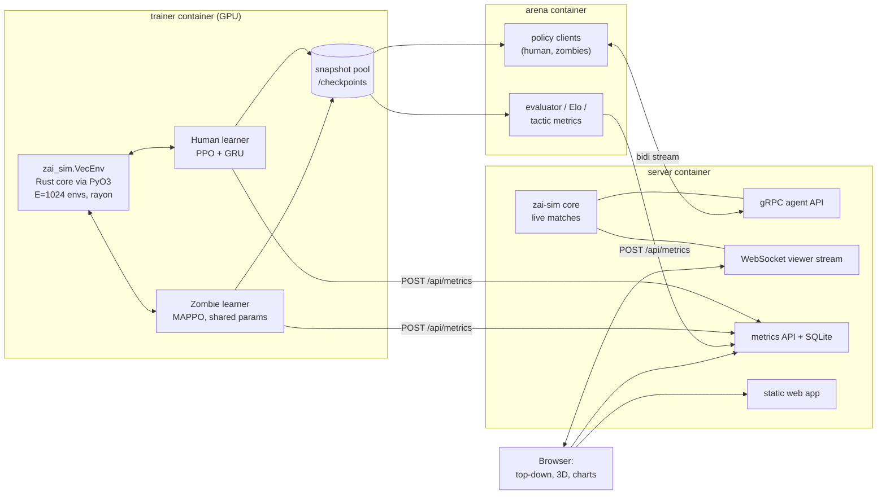
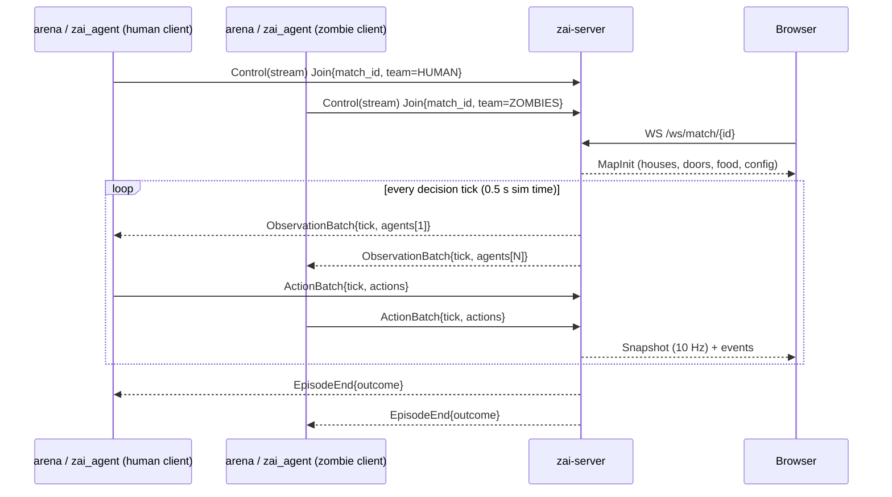

# ZAI Architecture

- **Status:** Proposed
- **Date:** 2026-11-24
- **Source of truth:** `ZAI_PRD.md` (summarized in `CLAUDE.md`)
- **Resolved by the user before this proposal:** human vision radius is 100 m; the food speed penalty is linear on base speed (`speed = 1.0 * max(0, 1 - 0.2 * carried)`, so 5+ packages means zero speed).
- **User decisions on the open questions (2026-11-24):**
  - Q1: accepted. Training runs the Rust core in-process; the server's gRPC agent API is used for evaluation and live matches.
  - Q2: option (b). Zombies perceive noise, touch, the static map layout, 10 m proximity rays and up to 8 peers within 50 m. No learned communication (kept only as an ablation).
  - Q3: food respawns by default (see section 3.2).
  - Q4: zombie count and food count defaults may be tuned by the M2 balance sweep. Speeds and noise radii stay as in the PRD.
  - Q5: pilot runs locally (macOS, CPU-only containers); full training later moves to a Linux server with an NVIDIA Tesla P100 (see section 6).
  - Q6: surviving to the 20 min cap counts as a human win in evaluation.
  - P100 server: 24 CPU cores, 64 GB RAM.
  - Q7 (after the M2 balance sweep): zombie speed raised from 0.5 to 0.7 m/s in the PRD; then human vision narrowed to a 120-degree frontal field of view, with defaults of 20 zombies and 120 food (scripted bots: ~12% caught, ~48% starved, ~39% survived).

---

## 1. Summary

A single deterministic simulation core written in **Rust** (`zai-sim`) is the only implementation of the game rules. It is used in two ways:

1. **Training (throughput path):** compiled into a Python extension (PyO3 + maturin) that exposes a *batched vector environment*: one `step()` call advances 1024+ environments in parallel on all CPU cores (rayon), writing observations into preallocated NumPy buffers with zero copies. A single **trainer** container (PyTorch, CUDA) hosts two independent learners: the **human learner** (recurrent PPO) and the **zombie learner** (recurrent MAPPO with parameter sharing and a centralized critic). No network hop exists in the training loop.
2. **Observation / evaluation (PRD path):** the **game server** (Rust, axum + tonic) embeds the same core, runs live matches, exposes a **gRPC agent API** through which policy processes receive observations and send actions (satisfying "models communicate with the game server"), streams state to the **web viewer** over WebSocket, and stores/serves training metrics. An **arena** container loads checkpoints, plays them against each other through the server and in-process, and computes Elo and tactic metrics.

Because both paths call the same Rust functions for physics *and* observation encoding, a policy trained in-process behaves identically when it drives a live match over gRPC.



---

## 2. Components and responsibilities

| Component | Language / libs | Responsibility |
|---|---|---|
| `zai-sim` (crate) | Rust, `glam` (vectors), `rand_chacha` (seeded RNG) | Pure game logic, no I/O: map generation, movement, collisions, doors, food, hunger, noise routing, line-of-sight, observation/state encoding, rewards, termination. Deterministic given `(config, seed, actions)`. |
| `zai-py` (crate) | Rust, `pyo3`, `numpy` (rust-numpy), `rayon`, built with `maturin` | Python module `zai_sim`: `VecEnv` (batched, GIL released, parallel over envs, zero-copy buffers) and `Env` (single env, for tests/debug). |
| `zai-server` (crate) | Rust, `tokio`, `axum` (HTTP/WebSocket), `tonic` (gRPC), `rusqlite`, `rmp-serde` (MessagePack) | Match manager (create/run/pause, real-time with speed multiplier or lockstep), gRPC agent API, viewer WebSocket stream, replay recording, metrics ingest/query, serves the built web app. |
| `zai_env` (Python pkg) | `gymnasium`, `pettingzoo` | Thin wrappers: PettingZoo `ParallelEnv` over `zai_sim.Env` (API compliance tests, debugging, third-party libs) and a typed wrapper over `VecEnv` used by the trainer. Config loading (YAML merge; validation is delegated to Rust) and named access to observation fields using the layout exported by Rust (`zai_sim.obs_layout()`). |
| `zai_rl` (Python pkg) | `torch` 2.x | Models, recurrent PPO / MAPPO, rollout storage, co-training scheduler, snapshot pool, curriculum, scripted bots, metrics logging (TensorBoard + server push). CleanRL-style single-file-per-algorithm code, no framework. |
| `zai_agent` (Python pkg) | `grpcio`, `torch` (CPU ok) | Remote policy client: connects to the server, loads a checkpoint, batches all agents of its team per decision tick. |
| `arena` (Python entrypoint) | `zai_rl`, `zai_agent` | Cross-play evaluation, Elo, tactic metrics, showcase matches on the server for the viewer. |
| `web` | TypeScript, Vite, PixiJS (top-down), Three.js (3D), uPlot (charts), `@msgpack/msgpack` | Viewer UI. Built in a Node stage and served as static files by `zai-server`. |

### Repository layout

```
zai/
  Cargo.toml                 # Rust workspace
  crates/
    zai-sim/                 # core simulation (no I/O)
      src/{config,map,physics,doors,food,noise,vision,obs,reward,env}.rs
      benches/step.rs        # criterion benchmark
    zai-py/                  # PyO3 bindings -> python module `zai_sim`
    zai-server/              # axum + tonic server
  proto/
    zai/v1/agent.proto       # gRPC agent API
  python/
    pyproject.toml           # uv-managed; packages below
    zai_env/
    zai_rl/
      algos/{ppo_human.py, mappo_zombie.py}
      models/{encoders.py, human.py, zombie.py, critics.py}
      league/{pool.py, elo.py, scheduler.py}
      curriculum.py
      bots/{scripted_human.py, scripted_zombie.py}
      metrics.py
      train.py               # entrypoint
    zai_agent/
    arena/
    tests/
  web/
    src/{topdown/, fps3d/, charts/, net/}
  configs/
    env/default.yaml         # PRD values
    curriculum/default.yaml
    train/default.yaml
  docker/
    server.Dockerfile
    trainer.Dockerfile
    arena.Dockerfile
    dev.Dockerfile           # toolchain image for builds/tests
  compose.yaml
  compose.gpu.yaml           # GPU override (NVIDIA)
  Makefile                   # wraps `docker compose run ...`
  docs/ARCHITECTURE.md
```

Configuration: YAML files (`configs/env/`) merged in Python and validated by the Rust `serde` schema (`deny_unknown_fields`), which is the single source of truth; Python passes configs to Rust as JSON. Environment-variable overrides are applied by Rust. The PRD-mandated variables are `ZAI_ZOMBIE_COUNT` (default 20) and `ZAI_FOOD_COUNT` (default 120).

---

## 3. Environment specification

### 3.1 Time

| Parameter | Value | Reason |
|---|---|---|
| Physics tick | 10 Hz (`dt = 0.1 s`) | Human moves 0.1 m/tick, zombie 0.07 m/tick; relative closing speed 0.17 m/tick is far below the 0.6 m contact distance, so no tunneling. |
| Decision rate | 2 Hz (action repeat 5 ticks) | One decision per 0.5 s keeps horizons tractable: the 90 s hunger cycle is 180 decisions. |
| Episode cap | 20 min sim time = 2400 decisions (configurable) | Truncation, not termination: value is bootstrapped. |
| Discount | `gamma = 0.995` (effective horizon ~200 decisions = 100 s) | Covers one hunger cycle. |

### 3.2 World geometry

- Map: 500 x 500 m, solid boundary (entities are clamped).
- Entities are circles of radius 0.3 m. Human-zombie contact (`distance <= 0.6 m` with line of sight, so touching through a wall does not count) kills the human. Zombie-zombie overlap is resolved by a soft push (no blocking deadlocks).
- Houses: 10, each a 12 x 8 m rectangle with wall segments; a 1.5 m door gap at the center of the front wall and of the back wall (opposite walls). Placement: stratified 5 x 2 grid (cells 100 x 250 m), house center jittered uniformly within +/-30 m of the cell center, orientation in {0, 90, 180, 270} degrees, regenerated per episode from the seed. This satisfies "uniform distribution" while guaranteeing spacing.
- Doors: a door is a wall segment that is solid when closed. Initial state: both doors open. The human can close an open door when within 2.0 m of it; that door closes and the *other* door of the same house opens (PRD rule). A door cannot be closed while any entity overlaps the doorway. Doors cannot be opened directly. Consequence: after the first close, every house has exactly one open door, so houses are chokepoints, never sealed refuges.
- Food: `ZAI_FOOD_COUNT` packages placed uniformly at random (rejection-sampled outside walls, at least 5% placed inside houses). Respawn is on by default: each package picked up is replaced by a new one at a uniformly random valid position after `food_respawn_interval_s` (default 60 s; set `null` to disable), keeping the map population at `ZAI_FOOD_COUNT`. The interval is one of the M2 balance sweep parameters.
- Entity-entity and entity-food queries are brute force (at most 64 zombies and 128 food, cheaper than maintaining a spatial hash); walls are culled per house by its bounding circle.
- Grid for other house counts (curriculum): the `cols x rows` grid with the fewest empty cells, then the most square (10 -> 5 x 2, 3 -> 3 x 1, 6 -> 3 x 2); jitter is reduced if a cell is too small.

### 3.3 Human rules

- Spawn: random position at least 150 m from every zombie; inventory 0; hunger timer 90 s.
- Speed: `1.0 * max(0, 1 - 0.2 * carried)` m/s.
- Hunger: timer decreases continuously. When it reaches 0: if `carried >= 1`, one package is consumed automatically (`carried -= 1`, timer reset to 90 s); otherwise the human dies of starvation.
- Pickup is an explicit action (food within 1.5 m), which makes the 100 m pickup noise a choice.
- No attack, no drop action (see section 7).

### 3.4 Zombie rules

- Count `ZAI_ZOMBIE_COUNT`; during training sampled per environment group from a range (section 4.4) so the policy generalizes across counts.
- Speed 0.7 m/s (PRD originally 0.5 m/s, raised by the user after the M2 balance sweep), cannot interact with doors, blocked by walls and closed doors.
- Spawn: uniform random, at least 150 m from the human.
- Zombies are silent (they emit no noise; the human has no hearing).

### 3.5 Noise model

| Event | Radius | Emission |
|---|---|---|
| Human walking | 10 m | Once per decision step in which the human moved > 0.05 m, at the end position. |
| Food pickup | 100 m | On each successful pickup. |
| Door close | 200 m | On each successful close, at the door position. |

A zombie hears an event iff `distance(zombie, source) <= min(event_radius, hearing_radius=300)`. Walls do not attenuate. Source position is exact by default; `noise_localization_sigma` (fraction of distance, Gaussian) is available as a curriculum knob.

### 3.6 Observation spaces

All coordinates are world-frame deltas normalized by the stated range. Variable-size sets are fixed-size padded slots sorted by distance with a validity mask. Encoding lives in Rust (`obs.rs`) and is shared by trainer and server.

**Human actor observation** (flat `float32[584]`, plus action mask):

| Block | Shape | Features |
|---|---|---|
| Self | 16 | `x/500, y/500`, heading sin/cos, velocity `vx, vy` (m/s), `carried/5`, one-hot carried bucket {0,1,2,3,4,5+} (6), `hunger_timer/90`, inside-house flag, time since last own noise / 30 s |
| Visible zombies | 32 x 6 | `dx/100, dy/100, dist/100, vx/0.7, vy/0.7, valid` (within 100 m and line-of-sight) |
| Visible food | 16 x 4 | `dx/100, dy/100, dist/100, valid` |
| Houses (all 10) | 10 x 12 | `dx/500, dy/500`, rotation sin/cos, front door `dx, dy` /500, back door `dx, dy` /500, front closed, back closed (last observed state), door state currently visible, human inside this house |
| Ray cast | 64 x 3 | 64 rays over 360 degrees, range 100 m: `hit_dist/100`, hit-is-wall, hit-is-closed-door |

Vision is a 120-degree frontal cone around the heading (`human.vision_fov_deg`, adopted after the M2 balance sweep; 360 restores omnidirectional vision): with a field of view below 360 degrees, zombies, food and doors are only seen inside the cone around the heading, the 64 rays are spread across that cone instead of 360 degrees, and the critic's `sees_human` flag uses the same test), radius 100 m, occluded by walls and closed doors (LOS segment test). The heading is the direction of the last movement action; the human has no separate look action, so it turns its view by moving.

**Zombie actor observation** (per zombie, flat `float32[252]`):

| Block | Shape | Features |
|---|---|---|
| Self | 12 | `x/500, y/500`, heading sin/cos, `vx, vy`, inside-house flag, blocked-last-tick flag, time since last heard event / 30 s, `num_zombies/64`, episode time fraction, bias 1.0 |
| Heard noise buffer | 8 x 9 | FIFO of last 8 heard events (max age 30 s): `dx/300, dy/300, dist/300`, type one-hot {walk, pickup, door} (3), `age/30`, `fresh` (heard during the last decision step), `valid`. Consecutive walk events overwrite the newest walk slot if it is < 2 s old, so walking does not flush door/pickup events. |
| Peer zombies | 8 x 5 | 8 nearest zombies within 50 m: `dx/50, dy/50, dist/50, same-house flag, valid` |
| Houses (all 10, static map) | 10 x 8 | `dx/500, dy/500`, rotation sin/cos, front door `dx, dy`, back door `dx, dy` (door *state* not observed) |
| Proximity rays | 16 x 3 | 16 rays, range 10 m: `hit_dist/10`, hit-is-wall, hit-is-closed-door (local navigation sense, "touch") |

Zombies never observe the human directly; they only learn where the human is through noise.

**Global state for critics** (privileged, training only, `float32[1144]` padded): human (16: pos, velocity, carried, hunger, inside house id), zombies 64 x 8 (pos, velocity, inside-house, valid, distance to human, LOS-to-human flag), food 128 x 4 (pos, valid, inside-house), houses 10 x 10 (pos, rotation, door positions, door states), time features 4. The zombie critic additionally receives the evaluated agent's own actor observation (agent-specific global state, as in MAPPO).

### 3.7 Action spaces

Discrete, world-frame (consistent with world-frame observations; episodes are augmented with random 90 degree map rotations/flips).

| Agent | Space | Meaning |
|---|---|---|
| Human | `MultiDiscrete([17, 3])` | Head 1: 16 movement directions (22.5 degree steps) or stay. Head 2: `none`, `pickup`, `close_door`. Invalid choices are masked (`pickup` without food in 1.5 m; `close_door` without an open closable door in 2 m). Interaction executes before movement in the step. |
| Zombie | `Discrete(17)` | 16 directions or stay. |

Movement always uses the full available speed (the PRD defines a single walking speed). Wall contact uses slide resolution (the blocked component of the displacement is removed).

### 3.8 Rewards

Human (per decision step):
- `+0.005` per decision survived (= 0.01 per second).
- `-1.0` on death (caught or starved).
- Curriculum stages S0-S1 only: potential-based food shaping `F = gamma * Phi(s') - Phi(s)` with `Phi = -0.5 * [hunger_timer < 30 s] * min(dist_to_visible_food, 100)/100`, annealed to 0 before S2. Potential-based, so it does not change the optimal policy. **Replaced in M4:** the first pilot stayed at 0% survival for 650 k steps, and the formula had two flaws: with a negative potential and `Phi(terminal) = 0`, dying paid a bonus of up to `+scale` (cancelling most of the -1 death penalty), and picking up the nearest food lowered the potential (the target disappears). The implemented potential is `Phi = scale * (min(hunger + 90 * carried, 180) / 180 + 0.25 * proximity)`, `proximity = 1 - dist_to_nearest_visible_food / 100` (0 when none is visible): non-negative, so termination never pays; a pickup is worth about `+0.25 * scale` at the moment of pickup (reserve +0.5 minus the lost proximity of at most 0.25); eating from the inventory leaves it unchanged. S0 uses scale 1.0, always on (`human_food_shaping`, `human_food_shaping_reserve_s` in the config). The zombie distance potential has the same negative-potential issue (a starvation ending pays zombies up to `+scale * dist / map`); to be revisited in M5.

Zombies (shared team reward, identical for all zombies):
- `+1.0` to every zombie when any zombie catches the human.
- `-0.002` per decision (pressure to hunt rather than idle).
- Starvation of the human gives zombies nothing (their PRD objective is "find and attack", so starvation is not their win).
- Curriculum stages S0-S1 only: potential-based shaping on `Phi = -min_zombie_distance_to_human / 500` (privileged, computed in the env, never in the actor input), scale 0.5, annealed to 0 before S2. **Replaced in M5** by a non-negative per-zombie potential (section 4.6): `Phi_i = c * (1 - min(d_i, 100) / 100)`, `c` on a catch and 0 on starvation; S0 also sets the step penalty to 0.

Reward-hacking review:
- **Human hoarding**: self-limiting (2 packages already make the human slower than zombies: 0.6 vs 0.7 m/s; 5 freeze it); the pickup action is explicit, so there is no automatic trap. Tracked via the "carried distribution" metric.
- **Human freezing in silence**: legitimate "noise discipline" tactic, bounded by starvation (at most `(carried + 1) * 90 s`). Not a hack, but it can create a degenerate equilibrium if zombies never hear anything (section 8).
- **Zombies camping food/houses**: legitimate ambush tactic. The per-step penalty is small enough not to forbid it.
- **Shaping exploits** (e.g. zombies orbiting at constant distance): prevented by using potential-based shaping only and removing it entirely in S2.
- **Truncation bias**: truncated episodes bootstrap `V(s_T)`; treating truncation as death would teach the human that minute 20 is fatal.

### 3.9 Episode termination

| Condition | Type | Human | Zombies |
|---|---|---|---|
| Human contact with a zombie | terminal | -1.0 | +1.0 each |
| Hunger timer 0 with no food | terminal | -1.0 | 0 |
| 20 min sim time | truncation | bootstrap | bootstrap |

All agents end together. `VecEnv` auto-resets finished environments and returns the final observation in `info` for bootstrapping.

---

## 4. Training approach

### 4.1 Algorithms

**Human: recurrent PPO with an asymmetric (privileged) critic.**
- Actor: per-type entity encoders (MLP 64 per zombie/food/house slot, masked mean + max pooling), circular 1D conv over the 64 rays (2 layers, 32 channels), concat with self features, MLP 256, **GRU 256**, two categorical heads with masking. About 0.45 M parameters.
- Critic: separate network on the global state (entity self-attention, 2 layers, 64 dims, 4 heads, then MLP 256). Not shared with the actor, so privileged information cannot leak into the policy.

**Zombies: MAPPO (recurrent, parameter sharing, centralized critic, decentralized execution).**
- One actor network shared by all zombies: encoders as above, MLP 128, **GRU 128**, 17-way categorical head. About 0.15 M parameters. No agent ID input (zombies are homogeneous; symmetry breaking comes from different observations and sampling).
- Centralized critic: attention over global state + the agent's own observation embedding, outputs a per-agent value.
- No explicit communication channel by default. Coordination emerges from the shared policy, the centralized critic, peer observation within 50 m and the common signal (all zombies in range hear the same event). An optional learned 4-dim broadcast message to zombies within 50 m is planned as an ablation (section 8).

Why this pairing: the human is a single agent with rich vision, so plain PPO with memory is the right tool. Zombies are many homogeneous agents with a team reward, where MAPPO with shared parameters and a centralized critic is the strongest simple baseline (Yu et al. 2022) and scales to variable counts. Both are on-policy, so they share one rollout loop.

**Hyperparameters (starting point):** Adam lr `3e-4` (linear decay), clip 0.2, `gamma 0.995`, GAE `lambda 0.95`, entropy `0.01 -> 0.001`, 4 epochs (zombies 3), 8 minibatches, grad clip 0.5, value normalization (running mean/std), rollout 128 decisions per env, BPTT chunk 64 with stored hidden states at chunk start. Batch at E=1024: 131 k human transitions and ~1.3 M zombie transitions per iteration (10 zombies).

**Library choice:** custom PyTorch implementation (CleanRL-style) instead of RLlib/TorchRL. The co-training scheduler, opponent pools, mixed learning/frozen policies per env group and the batched Rust env do not fit framework abstractions cleanly, and both algorithms together are ~1.5 k lines. Alternatives considered: RLlib multi-agent (supports PettingZoo and policy mapping, but heavy and slow to iterate), TorchRL MAPPO, Sample Factory (fast, but weak multi-team support). The PettingZoo wrapper keeps those options open.

**As implemented in M4 (human only):** `python/zai_rl/` (`models/human.py`, `algos/ppo_human.py`, `envs.py`, `train.py`, config `configs/train/human_s0.yaml`). Differences from the plan above: the human critic is an MLP over the global state (512-256) instead of entity self-attention (revisit if the value fit is poor); the actor uses `nn.GRU` over whole BPTT chunks, running the encoders once over all steps and splitting the GRU only where an episode restarts (4-5x faster update than a per-step `GRUCell` loop on CPU, verified equal by a test); the actor has ~0.69 M parameters. Training envs are one `VecEnv` group per zombie count (S0: 2, 3, 4), with zombies played by the Python scripted bots. Curriculum stage configs (`configs/env/s0.yaml`) are loaded without the `ZAI_ZOMBIE_COUNT` / `ZAI_FOOD_COUNT` overrides, which apply to live matches and full-spec runs. Evaluation every 10 iterations plays 64 episodes against scripted zombies (3 zombies) and reports `eval/survived` next to `eval/baseline_survived` (scripted human). Measured S0 baselines (256 episodes): scripted human survives the 5 min cap in 80-85% of episodes (2-4 zombies), random human 0%. CPU pilot throughput (Apple Silicon, 128 envs, 4 torch threads): ~2.2 k env steps/s, dominated by the PPO update (~5 s per 16 k-step iteration vs ~2 s of rollout). **GPU run `human-s0-gpu1` (P100, `configs/train/human_s0_gpu.yaml`, 1024 envs, 2026-11-24):** 200 M env steps in 8770 s (2 h 26 min), ~23-26 k env steps/s end-to-end (~5.3 s per 131 k-step iteration). Evaluation (128 episodes, 3 scripted zombies) went from 0% survival (98% starved) to above the 82.8% baseline at iteration 139 (18 M steps, ~12 min) and finished at 96.9-98.4% survived, 0.8-2.3% caught, 0.8% starved (peak 99.2%). Ten exported replays of the final checkpoint (`python -m arena.export_replays`): 9 survived the 5 min cap, 1 caught at 155 s. M4 acceptance (survival above the scripted human baseline on S0) is met.

### 4.2 Rollout and process topology

One trainer process, one GPU. Each iteration:
1. Rust `VecEnv.step()` on CPU (all cores).
2. Batched GPU inference for all humans and all zombies (two forward passes).
3. After 128 decisions: compute GAE, run PPO update for the human and MAPPO update for the zombies (sequentially on the same GPU).

The two learners have separate networks, optimizers, checkpoints and metrics, so they are logically the "two trainers" of the PRD while avoiding cross-process lockstep, which would halve throughput.

### 4.3 Co-training schedule

Simultaneous training with an opponent pool. Environments are split into groups:

| Group | Share | Human policy | Zombie policy | Who learns |
|---|---|---|---|---|
| A | 50% | latest | latest | both |
| B | 25% | latest | sampled snapshot | human |
| C | 25% | sampled snapshot | latest | zombies |

- Snapshots saved every 20 M env steps per side to `/checkpoints/{human,zombie}/`. Pool capped at 50 per side (oldest evicted, but scripted bots and every 10th snapshot kept permanently).
- Sampling: prioritized fictitious self-play (PFSP), weight `p * (1 - p)` with `p` = current side's recent win rate against that snapshot, so training focuses on opponents it neither always beats nor always loses to.
- Scripted bots are always in the pool: *scripted zombie* (walk to the most recent heard event, else random waypoint wander), *scripted human* (flee visible zombies closer than 30 m, go to the nearest visible food while carrying fewer than 2 packages, else walk to a random house). The original "food when hunger < 45 s and carrying 0" rule starved: visible food can be 100 m (100 s) away.
- Imbalance guard: if one side's win rate in group A stays above 85% for 3 consecutive evaluations, the losing side gets an extra update epoch per iteration and the winning side's lr is halved until it recovers.

### 4.4 Curriculum

Stages are advanced by gates measured in the arena against the fixed scripted bots and the previous stage's best checkpoints.

| Stage | Map | Houses | Zombies (sampled) | Food | Cap | Shaping | Gate to advance |
|---|---|---|---|---|---|---|---|
| S0 | 150 x 150 | 3 | 2-4 | 20 | 5 min | on | Human beats scripted zombies (> 60% survive cap); zombies catch scripted human > 60% |
| S1 | 300 x 300 | 6 | 4-8 | 30 | 10 min | on, annealing | Same gates, plus group-A outcome between 25% and 75% |
| S2 | 500 x 500 | 10 | 6-16, eval at `ZAI_ZOMBIE_COUNT` | `ZAI_FOOD_COUNT` | 20 min | off | Final PRD spec |

Within a stage, `noise_localization_sigma` goes 0 -> 0.05. Starting houses/food counts scale with area so densities stay close to S2.

Budget estimate: S0 ~200 M env steps, S1 ~500 M, S2 1-3 B. At ~70 k env steps/s (section 5.1) that is roughly 1 h, 2 h and 4-12 h respectively on one GPU plus 16-32 CPU cores. On the target P100 server (24 cores, 64 GB RAM) the estimate stays at ~60-100 k env steps/s end-to-end, so S2 takes roughly 3-14 h; measure in M4 before committing to S2 budgets. **Measured in M4:** ~25 k env steps/s end-to-end on the P100 with 1024 envs and 20 simulation threads (section 4.1), about 3x below the estimate, so S1 takes ~6 h and S2 ~11-33 h at the current throughput. Where the time goes (rollout with CPU inference vs the PPO update on the GPU) has not been profiled yet; do it before S1/S2 budgets are committed.

### 4.5 Evaluation

Run by the arena every 20 M env steps, on fixed seeds (500 episodes per matchup), at the PRD spec (S2) unless stated.

- **Fixed-opponent evaluation:** latest human vs scripted zombies and vs a frozen "reference" zombie checkpoint per stage; latest zombies vs scripted human and vs a reference human.
- **Elo:** match outcome is zombie win (catch), human win (survives cap) or draw (human starves). Cross-play between the last 10 snapshots of each side and the scripted bots (anchored at Elo 1000). Reported as Elo curves per side.
- **Exploitability probe** (every 200 M steps): train a fresh best-response for 20 M steps against the frozen latest opponent; a large gap means the latest policy is exploitable (cycling).

Tactic metrics (logged per evaluation, these show *what* is learned, not just reward):

| Side | Metric | Definition |
|---|---|---|
| Human | Survival time distribution | median, p10, p90; split by cause of death |
| Human | Food efficiency | packages eaten / picked; mean carried; fraction of time with `carried >= 3` |
| Human | Noise discipline | noise events per minute by type; pickups made while a zombie is within 100 m |
| Human | Door usage | closes per episode; *defensive closes* (a zombie within 30 m of the closed door at close time); escapes via the opposite door within 20 s |
| Human | House usage | fraction of time inside houses; zombie distance when entering |
| Zombies | Catch rate, time to catch | per zombie count |
| Zombies | Noise response | latency from a heard event to movement toward it; fraction of zombies that respond vs stay as sentinels |
| Zombies | Search dispersion | mean pairwise distance while no event heard in 30 s (spread-out search vs clumping) |
| Zombies | Encirclement | for zombies within 50 m of the human, max angular gap; encircled if < 120 degrees; fraction of catches preceded by encirclement |
| Zombies | Flanking | distinct approach sectors (8 sectors) of the 3 nearest zombies in the 30 s before a catch |
| Zombies | Door coverage | while the human is in a house, fraction of time both doors have a zombie within 10 m |

Baselines for every metric come from the scripted bots and random policies; "emergent tactics" means sustained improvement over those baselines, not just reward growth.

### 4.6 M5 plan: zombie training

Decisions accepted by the user (2026-11-24): zombie step penalty 0 on S0; per-agent distance shaping (team `min` kept for ablation); train against the scripted human only, with the frozen M4 human as an evaluation opponent; acceptance relative to the measured scripted-zombie baseline (the S0 gate of section 4.4 to be revisited in M6); observation normalization by `map_size_m` kept until M6 (fix it before S1, since changing it now invalidates the M4 checkpoint used as an evaluation opponent).

**As implemented (code for pilot stages 1-3):** `crates/zai-sim` (`Env::zombie_potentials`, `Env::zombie_rewards`, `reward.zombie_distance_shaping_range_m` / `_mode`; `StepResult.zombie_reward` is now only the team part), `python/zai_rl/` (`algos/common.py`, `algos/mappo_zombie.py`, `models/zombie.py`, `envs.ZombieTrainingEnv`, `policy.RecurrentZombiePolicy`), configs `configs/train/zombie_s0{,_gpu}.yaml`, `make train-zombie{,-gpu}`. Differences from the plan below: the entrypoint is a separate module `zai_rl.train_zombie` instead of a `side` switch in `train.py` (the human path stays untouched); `HumanTrainingEnv` was kept and `ZombieTrainingEnv` added next to it (shared `group_sizes`), to be merged into one `MatchTrainingEnv` for M6; minibatches split the sequences with `tensor_split` because the agent count depends on the group split (256 envs give 767 agents); the actor uses 32-unit entity encoders and a 64-unit ray projection (0.17 M parameters). First CPU measurement (64 episodes per count): scripted zombies catch the scripted human in 6.8% of S0 episodes (2 zombies 1.6%, 3 zombies 6.2%, 4 zombies 12.5%), random zombies 0%; the trainer measures it again at startup with 256 episodes per count.

**Data layout: flat agent axis, no padding.** Each env group has a fixed zombie count, so the total number of zombie agents `A = sum_g E_g * N_g` is constant for the whole run (S0, E=1024, counts 2/3/4: A ~ 3072). Zombie tensors are `[A, 252]` with a static `agent_env [A]` index (and `agent_slot [A]`). Rollout buffers are `[T, A, ...]`, so `gae()`, the `[T, E] -> [chunks*E, L]` BPTT reshape and the `h0` storage of `ppo_human.py` apply unchanged with `E` replaced by `A`. Per-env arrays (`done`, `state`) are broadcast with `agent_env`. This replaces the "pad to `N_max` with a validity mask" sketch of section 5.1; `zombie_valid` is all-true inside a group and is only asserted.

**Reuse and new code (mapped onto M4):**

| Piece | M4 code | M5 action |
|---|---|---|
| GAE, `RunningMeanStd`, `EpisodeStats`, `save_checkpoint`, BPTT reshape, clipped PPO loss | `algos/ppo_human.py` | Move to `algos/common.py`; `HumanPPO` imports them (no behavior change, existing tests must pass). |
| GRU over segments split at episode starts | `HumanActor.sequence` | Extract `run_gru_segments(gru, x, h0, starts)` into `models/encoders.py`; used by both actors. |
| `SetEncoder`, `RayEncoder`, `mlp` | `models/encoders.py` | Reused as is (16 zombie rays -> 4 conv positions). |
| Env groups + fixed opponent | `envs.HumanTrainingEnv` | Generalize to `MatchTrainingEnv(groups, human_factory=None, zombie_factory=None)`: the side without a factory is supplied by the caller; `step()` returns both sides' views (human `[E]`, zombies flat `[A]` including `final_zombie_obs` / `final_state` regrouped). `HumanTrainingEnv` stays as a thin wrapper. This is also the M6 group A/B/C structure. |
| Actor | `models/human.py` | New `models/zombie.py`: `ZombieActor` (self 12 + `SetEncoder` over heard 8x9 / peers 8x5 / houses 10x8 with valid masks + `RayEncoder` 16x3 -> MLP 128 -> GRU 128 -> 17 logits, no mask, no agent id), `step` and `sequence` with the same equivalence test as the human. |
| Critic | `HumanCritic` (MLP on state) | `ZombieCritic`: agent-specific global state `concat(state[agent_env], own_obs)` = 1396 -> 512 -> 256 -> 1, per-agent value. Store `state` per env `[T, E, 1144]` (0.6 GB at E=1024) and gather at update time, not per agent (2.2 GB). |
| Algorithm | `HumanPPO.collect/update` | New `algos/mappo_zombie.py` `ZombieMAPPO`: per-agent rewards, per-agent GAE and values, advantage normalization per minibatch over agents, value normalization, truncation bootstrap from `final_zombie_obs` + `final_state`; hyperparameters as section 4.1 with 3 epochs, 8 minibatches, `hidden 128`. |
| Entrypoint | `train.py` (human only) | `TrainConfig.side: human | zombie` plus `opponent` and `mappo` sections; checkpoints under `/checkpoints/zombie/<run_id>/`; `MetricsLogger(run_id, "zombie")` (the server already accepts `zombie`). Configs `configs/train/zombie_s0.yaml` (CPU pilot, 256 envs) and `zombie_s0_gpu.yaml` (1024 envs, 20 sim threads); Makefile `train-zombie`, `train-zombie-gpu`. |
| Eval policy wrapper | `policy.RecurrentHumanPolicy` | New `RecurrentZombiePolicy(actor, num_envs, num_zombies)`: `act([E, N, 252]) -> [E, N]`, `reset(done)` clears the N hidden states of finished envs; `from_checkpoint`. |
| Replays | `arena/export_replays.py` (human checkpoint only) | Add `--zombie-checkpoint` and `--human {scripted,random,checkpoint}`; `record_episode` is already policy-agnostic; replay field `zombies: "policy"` (`ReplayAgent::Policy` exists). |

**Rewards for M5 (replace the section 3.8 zombie shaping):**
- Distance potential, per agent: `Phi_i(s) = c * (1 - min(d_i, D) / D)` with `d_i` the distance of zombie `i` to the human, `c = 0.5`, `D = 100 m` (a constant, so the per-meter signal does not change with the map size). Non-negative. Terminal potentials: `Phi_i(Caught) = c` (the value at `d = 0`) for every zombie, `Phi_i(Starved) = 0`; truncation uses the real `Phi_i(s_T)` and bootstraps. Per episode the shaping sums to `gamma^T * Phi_T - Phi_0`: a starvation ending adds nothing beyond the policy-independent `-Phi_0`, a catch adds an aligned bonus `+c * gamma^T` (catch effectively worth up to 1.5), so neither ending can be exploited. The current formula (`-scale * min_d / map_size`, terminal 0) paid up to `+0.5 * 212 / 150 ~ +0.71` on S0 for a starvation ending. The `(gamma - 1) * Phi` term costs at most `0.0025` per decision when close without catching, which pushes towards closing the gap (aligned), unlike the old negative form, which paid for staying far. Implemented in Rust (`Env::zombie_potential` per agent); `VecEnv` returns `zombie_reward [E, N]`; the team mode (nearest zombie) stays as `zombie_distance_shaping_mode: team_min` for ablation.
- `zombie_step_penalty: 0` on S0. With `-0.002` per decision and a low catch probability, continuing is worth about `-0.002 / (1 - 0.995) = -0.4`, while a starvation ending is worth 0, so making the human starve is worth ~40% of a catch, which turns into a food-guarding objective that the PRD does not ask for. `gamma` already gives zombies a preference for early catches.
- Catch `+1.0` shared by every zombie, unchanged.

**S0 configuration:** `configs/env/s0.yaml` as in M4 (150 x 150 m, 3 houses, 20 food, 5 min cap, spawn distance 50 m, 120-degree human field of view, zombies 0.7 m/s), training counts 2/3/4 in equal groups, opponent `ScriptedHuman` (reserve 2, flee 30 m).

**Baseline and acceptance:** the scripted-zombie catch rate against the scripted human on S0 has not been measured (M4 only logged the human's 82.8% survival). The trainer measures it at startup: `arena.matches.play` with scripted human vs scripted zombies, 256 episodes per count (2, 3, 4) on fixed seeds, reporting `eval/baseline_caught` per count and pooled with a Wilson 95% interval; random zombies are logged as the floor. Evaluation every 10 iterations uses the same seeds (paired). Acceptance: pooled learned catch rate above the baseline with non-overlapping 95% intervals (at 768 episodes and p ~ 0.1 the interval is about +/-2.1 points). Also reported, not gating: catch rate against the frozen M4 human (`human-s0-gpu1` latest), time to catch, starved share, mean nearest-zombie distance.

**De-risking before the GPU run:**
1. Tests (CPU, minutes): `ZombieActor.sequence` equals repeated `step` with resets; flat-agent regrouping round-trip; per-agent GAE stops at env done; truncation bootstrap uses `final_zombie_obs`; Rust rule tests for the potential (starvation ending pays 0, catch step pays `+1 + gamma * c - Phi`).
2. Sanity run against `RandomHuman` (noisy, no fleeing), 128 envs, 2 M env steps (~15 min on the pilot): catch rate must clearly exceed scripted zombies vs random human.
3. Pilot against the scripted human, 256 envs, 5-10 M env steps: go if the mean nearest-zombie distance falls, critic explained variance > 0.2 and `eval/caught` trends above the baseline.
4. Read `perf/rollout_s` / `perf/update_s` of `human-s0-gpu1` (already logged) before the long run. Expected GPU throughput ~15-25 k env steps/s (45-75 k agent steps/s; the simulation cost equals M4 because `VecEnv` always encodes all observations; the update handles 3x more transitions with a smaller network), so 200 M env steps take ~2.5-4 h.

---

## 5. Communication protocols and data flow

### 5.1 Training loop (in-process)

```python
venv = zai_sim.VecEnv(config, num_envs=1024, seed=0, num_threads=20)  # P100 server: 24 cores, 4 left for the trainer process and OS
obs = venv.reset()
# obs: human_obs [E, 584] f32, human_mask [E, 20] bool,
#      zombie_obs [E, N, 252] f32, zombie_valid [E, N] bool,
#      state [E, 1144] f32
obs, rew, term, trunc, info = venv.step(human_actions,   # [E, 2] i64
                                        zombie_actions)  # [E, N] i64
```

- Environments are partitioned into groups with a fixed `N` (zombie count) per group, so tensors are dense per group without ragged indexing; groups are concatenated for inference with padding to `N_max` and a validity mask.
- `step()` releases the GIL, runs `rayon` over envs, writes into preallocated buffers exposed as NumPy views; the trainer pins them and copies to GPU once per step (~3 MB at E=1024, N=10).

Throughput estimate (to be validated in M1 with a `criterion` benchmark):

| Option | Estimated env steps/s | Notes |
|---|---|---|
| In-process Rust `VecEnv` (recommended) | raw sim ~250-300 k on 16 cores (~40-60 us per env decision step incl. 5 ticks and obs encoding; **measured in M1: 9.2 us per decision step with all observations, ~108 k steps/s per core on Apple Silicon, 1.7 us without observations**); end-to-end with inference and PPO updates ~50-100 k | Per decision step and env: ~64 human rays + 16 rays x N zombies against ~20 culled segments each, ~5 k segment tests |
| Remote, batched gRPC (one message per team per step for all envs) | ~20-50 k | ~12 KB of observations per env step, ~12 MB per batch at E=1024; protobuf serialization dominates |
| Remote, per-env WebSocket/gRPC lockstep | ~1-3 k per connection | Round-trip latency (0.3-1 ms) per step kills throughput |
| Python simulation (NumPy, vectorized) | ~10-30 k | Ray casting and door logic are awkward to vectorize |

### 5.2 Live matches and viewer



**gRPC agent API** (`proto/zai/v1/agent.proto`, sketch):

```proto
service AgentService {
  rpc Control(stream AgentMessage) returns (stream ServerMessage);
  rpc ListMatches(ListMatchesRequest) returns (ListMatchesResponse);
}
message AgentMessage {
  oneof msg { Join join = 1; ActionBatch actions = 2; }
}
message ActionBatch { uint64 tick = 1; repeated AgentAction actions = 2; }
message AgentAction { uint32 agent_id = 1; repeated int32 action = 2; }
message ServerMessage {
  oneof msg { ObservationBatch obs = 1; EpisodeEnd end = 2; }
}
message ObservationBatch {
  uint64 tick = 1;
  uint32 obs_dim = 2;
  repeated uint32 agent_ids = 3;
  bytes obs = 4;            // little-endian f32, [len(agent_ids), obs_dim]
  bytes action_mask = 5;    // packed bools, may be empty
  repeated float reward = 6;
}
```

Observations are raw `f32` bytes produced by the same Rust encoder as training, so there is no schema drift. Match modes: `lockstep` (server waits for both teams; used for evaluation, runs as fast as clients answer) and `realtime` (configurable speed x1-x16; if actions miss a 200 ms deadline the previous action is repeated).

**As implemented in M3** (differences from the sketch below): live server matches are played by bots ported to Rust (`zai_sim::bots`, behaviorally similar to the Python bots, used only for server matches and demos) until the gRPC agent API lands in M7; one `snapshot` frame is sent per decision step (2 Hz sim time, i.e. 32 frames/s at x16) and the browser interpolates positions between them instead of 10 Hz frames; snapshots carry the full list of active food (about 1-2 KB per frame at 20 zombies / 120 food) instead of diffs; speed is x0.25-x16 or 0 for unthrottled (tests, evaluation); replays are JSON files `data/replays/{match}-e{episode}.json` with the action log and the final `state_hash`, re-simulated for playback and seek. HTTP API: `GET/POST /api/matches`, `GET /api/matches/{id}`, `POST /api/matches/{id}/control` (`speed`, `paused`, `stop`, `auto_restart`), `GET /api/replays`, `GET /api/replays/{id}`, `GET/POST /api/metrics`, `GET /api/runs`, `GET /api/metrics/stream` (SSE), `GET /api/config/default`, WebSockets `/ws/match/{id}` and `/ws/replay/{id}` (JSON commands `speed`, `pause`, `play`, `seek`).

**Viewer WebSocket** (`/ws/match/{id}`, MessagePack):
- `MapInit` once: map size, houses (pos, rotation, door segments), food positions, config.
- `Snapshot` at 10 Hz: `tick`, human `{x, y, heading, carried, hunger}`, zombies `[[id, x, y, heading]]`, `door_states` bitset (20 bits), food removed since last snapshot, noise events since last snapshot `[[type, x, y, radius]]`. Under 1 KB per frame at 10 zombies.
- Views: top-down (PixiJS: houses, doors, food, entities, vision circle, noise rings, zombie hearing radii on hover) and 3D first-person (Three.js: extruded houses from the same segments, billboard zombies, camera at the human position/heading, fog at 100 m to match vision).
- Replays: every server match is stored as `(config, seed, action log)` (tens of KB); the server re-simulates them deterministically for playback and scrubbing.

### 5.3 Metrics

- Trainer and arena push scalars every iteration/evaluation: `POST /api/metrics` with `{run_id, model: "human"|"zombie"|"arena", step, wall_time, scalars: {...}}`. The server stores them in SQLite (`/data/metrics.db`).
- Viewer reads history with `GET /api/metrics?run_id&model&keys&since` and live updates with SSE `/api/metrics/stream`; charts with uPlot (reward, episode length, losses, entropy, KL, Elo, tactic metrics).
- The trainer also writes TensorBoard event files to `/runs` for deep debugging (optional `tensorboard` compose service). W&B is an optional sink, off by default.
- Training environments never stream state to the viewer; only server matches do.

---

## 6. Infrastructure and containers

| Service | Image | Notes |
|---|---|---|
| `server` | multi-stage: `rust:<pinned>-bookworm` builds `zai-server`; `node:<pinned>-slim` builds `web/`; runtime `debian:bookworm-slim` | Ports 8080 (HTTP/WS/SSE), 50051 (gRPC). Volume `data`. |
| `trainer` | multi-stage: Rust builder runs `maturin build --release` to produce the `zai_sim` wheel; runtime `python:3.12-slim-bookworm` + `torch==2.8.0` from the PyTorch index selected by the `TORCH_INDEX` build arg (`cpu` for the pilot, `cu126` for the P100 server; the official `pytorch/pytorch` images are amd64-only, which would force emulation on the Apple Silicon pilot machine) + wheel + `python/` via `uv` | GPU through `compose.gpu.yaml` (`deploy.resources.reservations.devices: [{driver: nvidia, count: all, capabilities: [gpu]}]`). `shm_size: 8gb`, `cpus` set to the host core count. Volumes `checkpoints`, `runs`. |
| `arena` | same Python image as trainer, CPU-only by default | Reads `checkpoints`, talks to `server` over gRPC, posts metrics. |
| `tensorboard` (optional profile) | trainer image | Port 6006, reads `runs`. |
| `dev` | toolchain image (Rust, Python, Node) | `make test`, `make bench`, `make lint` run inside it; nothing installed on the host. |

- Host prerequisites: Docker (with Compose v2). For GPU training additionally a Linux host with the NVIDIA driver and the NVIDIA Container Toolkit; these cannot live inside a container. Without them, `docker compose up` runs everything CPU-only (useful for development and viewer work).
- Where the GPU helps: batched policy inference (11 k agent observations per step at E=1024, N=10) and PPO/MAPPO updates over ~1.4 M transitions per iteration. Where it does not: the simulation, which is CPU-bound; scaling is by CPU cores and `num_envs`. With these small networks a single mid-range GPU will be underutilized; the CPU core count is the main purchase/allocation decision.
- Target GPU: NVIDIA Tesla P100 (Pascal, compute capability 6.0, 16 GB HBM2, no Tensor Cores, no bf16). Consequences: train in FP32 (no bf16 autocast; FP16 AMP gives little benefit for these small MLP/GRU networks); 16 GB is ample for the planned batch sizes. Recent CUDA toolchains are dropping Pascal (CUDA 13 removes it, and some newer PyTorch CUDA wheels no longer ship `sm_60` kernels), so the trainer image must pin a PyTorch build whose CUDA wheels still include `sm_60` (e.g. a `cu126` build) and the host driver must support that CUDA version. Verify in M0 with `torch.cuda.get_arch_list()` containing `sm_60` inside the container.
- Target server sizing (24 CPU cores, 64 GB RAM): `num_threads=20` for the simulation, `num_envs=1024` as the starting point (try 2048 if the GPU update step, not the simulation, dominates iteration time). A 128-step rollout at E=1024, N=20 (the default zombie count) holds ~6.8 k floats per env step (human obs 584 + 20 x 252 zombie obs + 1144 critic state), about 3.5 GB in FP32; E=2048 is ~7.1 GB. Both fit comfortably in 64 GB host RAM and 16 GB GPU memory; keep `shm_size: 8gb`.
- Pilot: the same images run CPU-only on macOS (no GPU override), with `num_envs` 128-256 and stages S0/S1 only. The PyTorch pin above also has CPU wheels, so the pilot and the P100 server use the same versions.
- If the CPU simulation becomes the bottleneck later, the fallback is a GPU simulation (JAX or NVIDIA Warp) of the same rules, validated against the Rust core with replay hash tests. Not planned initially.

---

## 7. PRD ambiguities and recommended defaults

| # | Ambiguity | Recommended default |
|---|---|---|
| 1 | Human vision radius | **Resolved:** 100 m. Default: 360 degrees, occluded by walls/closed doors. |
| 2 | Food speed penalty | **Resolved:** linear on base speed, zero at 5+ packages. |
| 3 | How eating works | Automatic consumption from inventory when the 90 s timer expires; starvation if inventory is 0. |
| 4 | Food pickup automatic or explicit | Explicit `pickup` action within 1.5 m (makes the noise a decision, avoids the 5-package freeze trap). |
| 5 | Food respawn | **Resolved:** on. Each picked package respawns at a random position after `food_respawn_interval_s` (default 60 s, tunable in M2). |
| 6 | Initial human state and spawn | Hunger 90 s, inventory 0, at least 150 m from every zombie. |
| 7 | Noise radius vs 300 m hearing radius | Heard iff distance <= `min(event_radius, 300)`; walls do not attenuate; exact source position. |
| 8 | Walking noise frequency | One event per decision step (0.5 s) with movement. |
| 9 | What zombies perceive besides noise | Static map layout (houses and door positions, not door state), 10 m proximity rays, 8 nearest peers within 50 m. **Resolved:** option (b). |
| 10 | Zombie communication | None by default; learned local message as an ablation. |
| 11 | Door initial state, opening, blocking | Both open at start; human closes within 2 m; cannot close if the doorway is occupied; doors are never opened directly (only by closing the twin). |
| 12 | House size and "uniform" placement | 12 x 8 m; stratified 5 x 2 grid with +/-30 m jitter and random 90 degree rotation. |
| 13 | Zombie-zombie collisions | Soft push, no hard blocking. |
| 14 | Map boundary | Solid. |
| 15 | Episode length | 20 min cap as truncation for training. **Resolved:** reaching the cap counts as a human win in evaluation. |
| 16 | Starvation outcome for zombies | Not a zombie win (no reward), draw in Elo. |
| 17 | "Models communicate with the game server" | Training runs the same Rust core in-process (throughput); evaluation and live matches use the server's gRPC agent API. **Resolved:** accepted. |
| 18 | "Trainers" plural | One trainer container hosting two independent learners (separate nets, optimizers, checkpoints, metrics). |
| 19 | Human action set | Move (16 directions or stay), pickup, close door. No running, no drop, no attack. |
| 20 | Zombie count variable | `ZAI_ZOMBIE_COUNT` (default 20) for evaluation/live matches; training samples a range around it. `ZAI_FOOD_COUNT` default 120. **Resolved after the M2 sweep (was 10 / 40).** |

---

## 8. Risks and open questions

1. **Game balance with PRD numbers (highest risk).** Zombies walked 0.5 m/s in the original PRD (now 0.7 m/s): crossing the 500 m map took ~17 min (now ~12 min). The loudest event is 200 m (door), pickups are 100 m, walking 10 m. With 10 zombies and 40 food (one package per ~6250 m^2, mean spacing ~80 m), a careful human may rarely be heard and zombies may almost never catch it, giving them no learning signal. Conversely, with few food packages, starvation dominates and the human's outcome barely depends on zombies. Mitigation: a balance sweep with scripted bots (M2) over zombie count (5-50) and food count (20-120) before RL; pick defaults where scripted zombies catch the scripted human in 20-60% of episodes. The curriculum gives early signal on small maps.
   **M2 result at the original 0.5 m/s (`docs/reports/balance_sweep_zombie_0.5mps.md`, 64 episodes per cell, zombies 5-64 x food 20-120, respawn 60 s): scripted zombies caught the scripted human in 0-1.6% of episodes in every cell; outcomes are decided by starvation (survival to the 20 min cap rises with food, from ~0-5% at 20 food to ~80% at 120 food with 5 zombies; more zombies mean more fleeing and more starvation). The same holds on the S0 map (0% caught). Catching works mechanically (scripted zombies catch a noisy random human spawned nearby in ~17% of episodes vs ~2% for random zombies), so the cause is the 2:1 speed ratio plus the 10 m walking noise: a human that flees at sight cannot be run down, only ambushed. No zombie/food count inside the allowed levers reaches the 20-60% target; settling this needs a decision on the PRD constants or the curriculum (open question below).**
   **Re-run at 0.7 m/s (`docs/reports/balance_sweep_reserve{1,2}.md`; scripted human keeping 1 or 2 spare packages): still 0-3% caught in every cell. A quick lever check (10/20 zombies, 80 food) with zombie speed 0.9 m/s and walking noise 25-50 m also stayed at 0-3% caught; stronger zombies only raise starvation, because the scripted human flees at sight and stops foraging. Conclusions: (1) the scripted zombies (chase the last noise) are too weak to measure catchability, since catching a faster human with 360-degree 100 m vision needs ambush or encirclement, which only learned zombies can show; (2) zombie pressure is currently converted into human starvation, which gives zombies no reward (section 3.8). Superseded by the 120-degree decision below. Previously proposed: keep 10 zombies / 40 food, evaluate catch rate with learned zombies in M5 (with S0-S1 shaping), and revisit whether starvation under pressure should reward zombies if the M5 catch rate stays near zero.**
   **Experiment, 45-degree human field of view (`docs/reports/balance_sweep_fov45.md`, zombies 0.7 m/s, reserve 2): catches finally appear and grow with zombie count and food (up to 11-13% at 35-50 zombies and 20% at 64 zombies / 120 food), but starvation becomes dominant (75-100% in every cell; survival to the cap at most 20%), because the scripted human finds far less food and has no "look around" action (heading only changes by moving). Not adopted; the PRD keeps 360-degree vision unless the user decides otherwise.**
   **Experiment, 120-degree field of view (`docs/reports/balance_sweep_fov120.md`, same settings): a middle ground. Catches of 6-12.5% appear already at 10-20 zombies with 80-120 food and reach ~20% at 50-64 zombies; the best mix is 20 zombies / 120 food (12.5% caught, 48% starved, 39% survived). Starvation is still the most common outcome in every cell (48-100%), less dominant than at 45 degrees. **Adopted by the user (2026-11-24): 120-degree field of view, 20 zombies, 120 food as defaults (PRD updated).**
2. **Degenerate equilibrium: silent human vs wandering zombies.** If silence dominates, zombies converge to random search and the human to "stand still, pick up only when needed". Detection: noise events per minute -> 0 and zombie search dispersion flat. Mitigations: food respawn (forces movement), larger zombie counts, or a small probability that zombies hear walking up to 20 m.
3. **Non-stationarity and strategy cycling.** Addressed by the PFSP opponent pool and exploitability probes; still the main source of training instability.
4. **Long-horizon credit assignment.** Starvation consequences arrive ~180 decisions later. Mitigations: `gamma 0.995`, recurrent policies with 64-step BPTT, hunger timer in the observation. Fallback: macro-actions (e.g. "go to house k", "go to food j") if flat actions plateau.
5. **Zombie sparse reward.** Shaping only in S0-S1; if catch rate in S2 stays near zero, the balance parameters (risk 1) are the lever, not more shaping.
6. **Host GPU.** The pilot runs on macOS, where Docker cannot access the Apple GPU, so pilot training is CPU-only with a small `num_envs` (128-256) and is limited to curriculum stage S0/S1. Full training moves to a Linux server with an NVIDIA Tesla P100 and the NVIDIA Container Toolkit. The P100 constraints and server sizing (24 cores, 64 GB RAM) are described in section 6; CPU cores remain the main throughput factor.
7. **Determinism.** `f32` results are deterministic only for the same binary and CPU architecture; replays store the build hash. Parallelism is across envs only, never inside an env.
8. **Build complexity of PyO3 wheels in Docker.** Contained in a multi-stage build; validated in M0/M2.

**Open questions for the user**

Q1-Q6 were answered on 2026-11-24 (see the header), as was the server sizing (24 CPU cores, 64 GB RAM). Open:

- Q7 was answered: zombie speed is now 0.7 m/s (PRD changed). See risk 1 for the re-run sweep; see risk 1 for the re-run sweep. After the field-of-view experiments the user adopted a 120-degree human field of view with 20 zombies and 120 food as defaults (2026-11-24); catch rates are re-evaluated with learned zombies in M5.

---

## 9. Incremental implementation plan

Each milestone ends with something runnable through `docker compose` / `make` and covered by tests.

| Milestone | Deliverable | Runnable / testable result |
|---|---|---|
| **M0 Scaffold** | Repo layout, Cargo workspace, `pyproject.toml`, `dev` image, `Makefile`, `compose.yaml`, CI running `make test` | `make test` passes in a container on an empty skeleton. |
| **M1 Simulation core** | `zai-sim`: map generation, movement, collisions, doors, food, hunger, noise routing, LOS, obs/state encoding, rewards, termination | Unit tests per rule (door twin logic, speed formula, noise ranges, starvation, contact death); property tests (no entity inside walls); determinism test (same seed + actions -> same state hash); `criterion` benchmark reporting env steps/s. Headless CLI runs random agents. |
| **M2 Python env + scripted bots + balance sweep** | `zai-py` `VecEnv`/`Env`, `zai_env` PettingZoo/Gymnasium wrappers, scripted human/zombie bots, sweep script | PettingZoo `parallel_api_test` passes; Rust-vs-Python obs parity test; sweep report (catch rate and survival by zombie/food count) used to settle defaults (risk 1). |
| **M3 Server + top-down viewer** | `zai-server` match manager, viewer WebSocket, replay storage, metrics API; `web` top-down view | Scripted-bot match visible live in the browser at x1-x16; replay playback; metrics endpoint accepts and serves test data. |
| **M4 Human training** | `zai_rl` recurrent PPO for the human vs scripted zombies (S0), trainer image with GPU override, TensorBoard + metrics push | Human survival beats the scripted human baseline on S0; curves visible in the viewer. |
| **M5 Zombie training** | MAPPO with shared params and centralized critic vs scripted human (S0) | Zombie catch rate beats the scripted zombie baseline on S0. |
| **M6 Co-training + arena** | Env groups A/B/C, snapshot pool with PFSP, arena with Elo, cross-play and tactic metrics, curriculum gates | Both sides improve in Elo against fixed anchors on S0-S1; tactic metric panels in the viewer. |
| **M7 gRPC agents + 3D view** | `agent.proto`, `zai_agent` client, server agent API, Three.js first-person view | Arena drives a live server match with two checkpoints over gRPC; obs parity with training verified by a hash test; 3D view follows the human. |
| **M8 Full spec runs** | S2 training at PRD values, long runs, ablations (zombie communication, noise sigma, respawn) | Report on emergent tactics using section 4.5 metrics vs baselines. |
